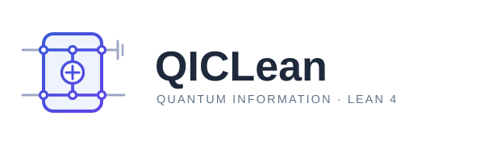
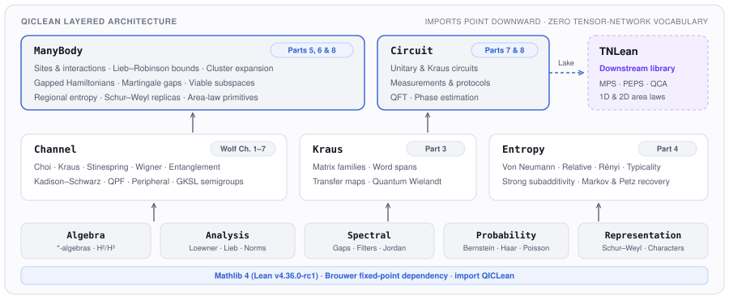

<div align="center">
  <a href="https://sirui-lu.com/QICLean/">
    <picture>
      <source media="(prefers-color-scheme: dark)" srcset="docs/logo-dark.svg" />
      <source media="(prefers-color-scheme: light)" srcset="docs/logo-light.svg" />
      
    </picture>
  </a>

  <p><b>Quantum information, channels, entropy, and many-body primitives, formalized in Lean 4.</b></p>

  <p>
    <a href="https://github.com/LionSR/QICLean/actions/workflows/pr-ci.yml"></a>
    <a href="https://github.com/LionSR/QICLean/actions/workflows/blueprint.yml"></a>
    
    
    
    
    
    
    <a href="LICENSE"></a>
  </p>

  <p>
    <a href="https://sirui-lu.com/QICLean/blueprint/">Blueprint (web)</a> ·
    <a href="https://sirui-lu.com/QICLean/blueprint.pdf">Blueprint PDF</a> ·
    <a href="https://sirui-lu.com/QICLean/docs/">API docs</a> ·
    <a href="https://sirui-lu.com/QICLean/paper-gaps/">Paper-gap notes</a> ·
    <a href="docs/getting_started.md">Getting started</a> ·
    <a href="https://github.com/LionSR/TNLean">TNLean</a>
  </p>
</div>

<p align="center">
  <picture>
    <source media="(prefers-color-scheme: dark)" srcset="docs/assets/overview-dark.svg" />
    <source media="(prefers-color-scheme: light)" srcset="docs/assets/overview-light.svg" />
    
  </picture>
</p>

**QICLean** is a [Lean 4](https://lean-lang.org/) library built on [Mathlib](https://github.com/leanprover-community/mathlib4) (Lean `v4.36.0-rc1`) that formalizes finite-dimensional quantum information theory, quantum channel and semigroup theory, quantum entropy and matrix concentration, and the generic many-body and circuit primitives used in gapped Hamiltonian and area-law proofs. The first three parts of the library closely follow M. M. Wolf's *Quantum Channels & Operations: A Guided Tour*; the remaining parts develop entropy, spectral filters, Lieb–Robinson dynamics, Schur–Weyl replicas, and quantum circuits.

QICLean was extracted from [TNLean](https://github.com/LionSR/TNLean), which formalizes tensor-network theory and consumes QICLean as a one-way Lake dependency (with prebuilt release archives via `preferReleaseBuild = true`). QICLean contains no tensor-network vocabulary. Every result is checked by Lean down to its axioms; the `sorries` and `axioms` badges above track the live counts, and discrepancies found against cited sources are documented in the [paper-gap notes](https://sirui-lu.com/QICLean/paper-gaps/) (`docs/paper-gaps/`).

The agent-driven formalization workflow used to build QICLean and TNLean is described in S. Lu, E. Tjoa, J. I. Cirac, *Multi-agent Autoformalization of Tensor Network Theory* ([arXiv:2607.07857](https://arxiv.org/abs/2607.07857)), carried out largely with agents running on [TeXRA](https://texra.ai). The entire library loads as a single import:

```lean
import QICLean
```

## What is formalized

### States, channels, and entanglement (Wolf Ch. 1–4)

- **Foundations of finite-dimensional quantum mechanics:** density matrices, partial traces, POVMs and measurements, the Schmidt decomposition, purification and steering, and Wigner's theorem (`wigner_rigidity`, `wolf_wigner_pureStateMatrix`).
- **Channel representations and normal forms:** positive and completely positive maps (`IsPositiveMap`, `IsCPMap`, `IsChannel`), the Choi–Jamiołkowski correspondence, Kraus representation and freedom, Stinespring dilation (`stinespring_schrodinger_representation`, `stinespring_dual_representation`), Lorentz normal form, and Koashi–Imoto decompositions.
- **Entanglement and conic structure:** positive-but-not-completely-positive maps, entanglement witnesses, Schmidt number, separability, partial transpose and reduction criteria, operator systems, and duality for conic and semidefinite programs.

### Operator inequalities, spectra, and semigroups (Wolf Ch. 5–7)

- **Operator inequalities:** the Kadison–Schwarz inequality (`kadison_schwarz`), multiplicative domains, conditional expectations, operator convexity, operator Jensen's inequality, matrix means, and Lieb concavity.
- **Quantum Perron–Frobenius theory and asymptotics:** irreducibility, primitivity, strictly positive stationary states (`exists_posDef_traceAdjoint_stationaryState`), peripheral spectra, fixed-point algebras, and asymptotic channel decompositions.
- **Quantum Wielandt theory:** span growth, rank-one extraction, and the general quantum Wielandt bound over finite Kraus families (`QICLean/Kraus/Wielandt/QuantumWielandt.lean`):

```lean
theorem wielandtIndex_le_general [NeZero D]
    (K : Fin r → Matrix (Fin D) (Fin D) ℂ)
    (hTP : IsTP K)
    (hIrr : IsIrreducibleMap (mapLM K))
    (hPrim : IsPrimitive (mapLM K)) :
    wielandtIndex K ≤ (D ^ 2 - krausRank K + 1) * D ^ 2
```

- **Dynamical semigroups:** continuous one-parameter CP semigroups and the GKSL / Lindblad generator characterization (`kossakowski_iff_lindblad`, `gksl_iff_tracelessBasisKossakowskiForm`).

### Entropy, recovery, and matrix probability

- **Entropy and information:** trace distance, pinching and majorization, Von Neumann, conditional, mutual, relative, and Rényi entropies, Pinsker-type bounds, typical states, and strong subadditivity (`QICLean/Entropy/StrongSubadditivity/Basic.lean`):

```lean
theorem strongSubadditivity
    (ρ_ABC : Matrix (Fin dA × Fin dB × Fin dC)
      (Fin dA × Fin dB × Fin dC) ℂ)
    (hρ_dm : ρ_ABC.PosSemidef ∧ ρ_ABC.trace = 1) :
    Entropy.vonNeumannEntropy ρ_ABC hρ_dm.1.isHermitian
      + Entropy.vonNeumannEntropy (traceAC_ABC ρ_ABC)
          (traceAC_ABC_isHermitian hρ_dm.1.isHermitian)
      ≤ Entropy.vonNeumannEntropy (traceC_ABC ρ_ABC)
          (traceC_ABC_isHermitian hρ_dm.1.isHermitian)
        + Entropy.vonNeumannEntropy (traceA_ABC ρ_ABC)
            (traceA_ABC_isHermitian hρ_dm.1.isHermitian)
```

- **Markov structure and recovery:** bipartite, tripartite, and dilation block forms for quantum Markov chains, Petz overlap data processing, and recovery maps.
- **Matrix probability and symmetry:** trace exponentials, the matrix Bernstein inequality, Gaussian and Haar measures, Poisson word statistics, and Schur–Weyl duality on tensor powers.

### Gapped ground states, many-body dynamics, and circuits

- **Spectral filters and area-law tools:** polynomial, Chebyshev, and Gaussian spectral filters, the detectability lemma, viable subspaces, Gaussian replacement of Schmidt sources, surprisal concentration, and symmetric-replica metrics and entropy transport.
- **Systems of sites and interactions:** placed operators on finite site lattices, Heisenberg dynamics and Lieb–Robinson commutator bounds, ground spaces, martingale spectral gaps, low-energy bases, translations on rings, and the high-temperature cluster expansion.
- **Quantum circuits and protocols:** two-level unitary gates, unitary and Kraus-family circuits on geometries, measurement circuits, channel protocols, the quantum Fourier transform, and phase estimation.

## Library organization

QICLean is organized into strict acyclic layers enforced by `scripts/check_import_layers.py` (see [`docs/library_layers.md`](docs/library_layers.md) and [`docs/import_structure.md`](docs/import_structure.md)):

| Path | Role |
| --- | --- |
| [`QICLean/Algebra`](QICLean/Algebra) | Matrices, Kronecker products, star subalgebras, operator Schmidt, words, permutations, and scalar group cohomology (`H²`, `H³`, L-symbols). |
| [`QICLean/Analysis`](QICLean/Analysis) | Norms, trace norm, Loewner order, functional calculus, exponentials and logarithms, operator means, convexity, majorization, and cluster-expansion calculus. |
| [`QICLean/Spectral`](QICLean/Spectral) | Eigenvalues, gaps above kernels and ground energies, Jordan forms, spectral radius, spectral projections, and polynomial/Gaussian filters. |
| [`QICLean/Channel`](QICLean/Channel) | Positive and CP maps, Choi/Kraus/Stinespring, Wigner, entanglement criteria, Kadison–Schwarz, Perron–Frobenius, peripheral spectra, and GKSL semigroups. |
| [`QICLean/Kraus`](QICLean/Kraus) | Finite matrix families `ι → Matrix n n ℂ`, word spans, transfer maps, mixed transfer maps, primitive fixed points, and quantum Wielandt bounds. |
| [`QICLean/Entropy`](QICLean/Entropy) | Classical, Von Neumann, conditional, mutual, relative, and Rényi entropies, strong subadditivity, Markov block forms, Petz recovery, and typicality. |
| [`QICLean/Probability`](QICLean/Probability) | Matrix concentration (Bernstein), Gaussian and Haar integration, Poisson words, and sampling estimates. |
| [`QICLean/Representation`](QICLean/Representation) | Symmetric-group actions on tensor powers, Young subgroups, characters, twirling, Bell states, coherent frames, and Schur–Weyl duality. |
| [`QICLean/ManyBody`](QICLean/ManyBody) | Site configurations, local interactions, Lieb–Robinson dynamics, gapped Hamiltonians, martingale gaps, regional entropy, viable subspaces, and replica transport. |
| [`QICLean/Circuit`](QICLean/Circuit) | Unitary gates, Kraus and measurement circuits, geometry placement, QFT, phase estimation, and channel protocols. |
| [`blueprint/`](blueprint), [`docs/`](docs) | Companion mathematical blueprint, layer architecture, getting-started guide, and paper-gap notes (`docs/paper-gaps/`). |

The top-level file `QICLean.lean` and directory aggregators are generated. After adding, moving, or removing a production `.lean` file, regenerate and verify them with:

```bash
python3 scripts/generate_import_aggregators.py
python3 scripts/generate_import_aggregators.py --check
```

## Building and using QICLean

### As a Lake dependency

Add QICLean to your `lakefile.toml` (pinning a release tag or commit; Lake automatically downloads prebuilt artifacts for tagged releases via `preferReleaseBuild = true`):

```toml
[[require]]
name = "QICLean"
git = "https://github.com/LionSR/QICLean.git"
rev = "main" # or pin a release tag / commit
```

### Building locally

The Lean toolchain is pinned in [`lean-toolchain`](lean-toolchain) and Mathlib in [`lakefile.toml`](lakefile.toml). Always fetch the prebuilt Mathlib cache before building:

```bash
git clone https://github.com/LionSR/QICLean.git
cd QICLean

# Fetch prebuilt Mathlib artifacts first; never compile Mathlib from source.
lake exe cache get

# Build the full library (default target: QICLean).
lake build

# Verify a single module with package Lean options and standard linters.
lake build QICLean.Channel.KrausMap.KrausRepresentation
```

### Blueprint and documentation

The mathematical blueprint is published at [sirui-lu.com/QICLean/blueprint](https://sirui-lu.com/QICLean/blueprint/) ([PDF](https://sirui-lu.com/QICLean/blueprint.pdf)) alongside the generated [API documentation](https://sirui-lu.com/QICLean/docs/). To build it locally on top of a compiled library:

```bash
lake build QICLean
cd blueprint
leanblueprint checkdecls
leanblueprint web   # or: leanblueprint pdf
```

### Documentation

| Guide | Covers |
| --- | --- |
| [`docs/getting_started.md`](docs/getting_started.md) | Installation, first reading path, and entry-point modules |
| [`docs/library_layers.md`](docs/library_layers.md) | Acyclic layer architecture and module placement rules |
| [`docs/import_structure.md`](docs/import_structure.md) | Import hierarchy and Archive policy |
| [`docs/project_conventions.md`](docs/project_conventions.md) · [`CLAUDE.md`](CLAUDE.md) | Local development workflow, cache policy, and style rules |
| [`docs/UPGRADE_RUNBOOK.md`](docs/UPGRADE_RUNBOOK.md) | Synchronized Lean/Mathlib upgrades with TNLean |

## References

- M. M. Wolf, *Quantum Channels & Operations: Guided Tour* (2012).
- M. Sanz, D. Pérez-García, M. M. Wolf, J. I. Cirac, *A quantum version of Wielandt's inequality*, [arXiv:0909.5347](https://arxiv.org/abs/0909.5347), IEEE Trans. Inf. Theory **56**(9), 4668–4673 (2010).
- E. H. Lieb, M. B. Ruskai, *Proof of the strong subadditivity of quantum-mechanical entropy*, J. Math. Phys. **14**, 1938–1941 (1973).
- P. Hayden, R. Jozsa, D. Petz, A. Winter, *Structure of states which satisfy strong subadditivity of quantum entropy with equality*, [arXiv:quant-ph/0304007](https://arxiv.org/abs/quant-ph/0304007), Commun. Math. Phys. **246**, 359–374 (2004).
- J. A. Tropp, *User-friendly tail bounds for sums of random matrices*, [arXiv:1004.4389](https://arxiv.org/abs/1004.4389), Found. Comput. Math. **12**, 389–434 (2012).
- M. B. Hastings, *An area law for one-dimensional quantum systems*, [arXiv:0705.2024](https://arxiv.org/abs/0705.2024), J. Stat. Mech. P08024 (2007).
- I. Arad, A. Kitaev, Z. Landau, U. Vazirani, *An area law and sub-exponential algorithm for 1D systems*, [arXiv:1301.1162](https://arxiv.org/abs/1301.1162) (2013).
- S. Lu, E. Tjoa, J. I. Cirac, *Multi-agent Autoformalization of Tensor Network Theory*, [arXiv:2607.07857](https://arxiv.org/abs/2607.07857) (2026).
- [Mathlib4](https://github.com/leanprover-community/mathlib4), the Lean 4 mathematics library.

## License

QICLean is released under the Apache License 2.0 (see [`LICENSE`](LICENSE)), matching TNLean's license.
