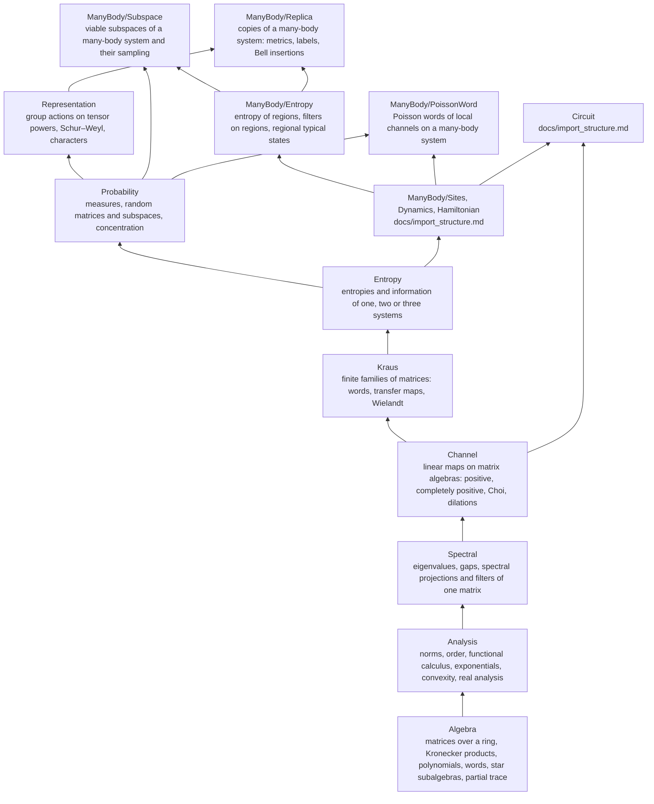

# Library layers below ManyBody and Circuit

Status: adopted 2026-11-21 (QICLean #1172, with #1173 for the spectral layer
and #1174 for the many-body modules of `Analysis` and `Entropy`). This document
orders the directories of QICLean that sit below the many-body and circuit
layers of `docs/import_structure.md`, and records where every module of
`Algebra`, `Analysis`, `Spectral`, `Topology`, `Probability`, `QPF`, `Entropy`
and `Representation`, and of the top level of `Channel` and `Kraus`, went. The
principles are those of the TNLean document *Many-body layer and circuit
library* (sections "Principles", "Where a declaration goes", "Directories and
namespaces", "Enforcement").
The dependency map of these layers, the remaining cleanup batches and the
decision on a separate many-body library are in `docs/library_architecture_record.md`.

## Principles

1. A layer is defined by the objects its statements mention, not by the paper
   or proof a module was written for. A declaration lives in the lowest layer
   whose objects suffice to state it.
2. Imports point downward. Two layers at the same height do not import each
   other; what both need moves down.
3. A directory is a layer or part of one, and its name states objects, never
   a proof technique or a source. A directory holds at most about forty
   modules at its top level and is divided by object beyond that. A module of
   one lemma is merged into the module that defines the object it is about.
4. The rules are checked by `scripts/check_import_layers.py`; recorded
   violations may only shrink.

## Layers



The eight single-system layers form a chain: each may import every layer
before it. `ManyBody/Sites` and the layers above it may import the
single-system layers up to `Entropy` (matrices, channels and entropy of one or
two systems, as in the TNLean architecture); `ManyBody/Subspace` adds
`Probability`, `ManyBody/Replica` adds `Probability` and `Representation`.
Subspaces and replicas are siblings. `ManyBody/PoissonWord` may import `ManyBody/Sites`,
`Dynamics`, `Hamiltonian` and `Probability`: it holds the words of local channels on a
many-body system driven by Poisson clocks (the layer `poisson_word` of
`scripts/check_import_layers.py`). The circuit layers are unchanged: they may
import the matrix layers (`Algebra`, `Analysis`, `Spectral`), the channel
layers (`Channel`, `Kraus`) and `ManyBody/Sites`. One exception: the party layer
`Circuit/Party` may import `Probability` only in modules of
`Circuit/Party/Compression/SourceSampling` that take laws, integrals or samples
(the layer `party_probability` of `scripts/check_import_layers.py`); every other
party module, including the deterministic sampling modules, stays below
`Probability`.

| Layer | Objects its statements mention | May import |
|---|---|---|
| `Algebra` | matrices over a ring or `ℂ`, entries, reindexing, rank, ranges, Kronecker products, permutations, polynomials and power sums, words and counts, star subalgebras of matrix algebras, the partial trace; no norms, limits or real functions | — |
| `Analysis` | norms, the Loewner order, functional calculus, exponentials and logarithms, convexity, majorization, scalar real analysis, optimization | Algebra |
| `Spectral` | eigenvalues and eigenvectors of one matrix, gaps above a kernel or a ground energy, spectral projections, spectral filters and truncations, low-energy subspaces, Jordan forms, spectral radius | Algebra, Analysis |
| `Channel` | linear maps between matrix algebras: positive and completely positive maps, their Kraus representations, Choi matrices, dilations, conditional expectations, operator systems, measurements, Schmidt decomposition and entanglement of bipartite vectors | the matrix layers |
| `Kraus` | a finite family of matrices `A : ι → Matrix`: its words and word spans, transfer map, blocking, injectivity and primitivity, mixed transfer maps of two families | the matrix layers, Channel |
| `Entropy` | von Neumann, relative, Rényi and Shannon entropy, mutual and conditional information, strong subadditivity and its equality case, typical subspaces | the layers above |
| `Probability` | measures, random variables, Haar and Gaussian random matrices and subspaces, Poisson words, concentration, measurability | the layers above |
| `Representation` | permutation and unitary group actions, Schur–Weyl duality, characters, Young diagrams, coherent states, copies of a system | the layers above |
| `ManyBody/Entropy` | entropy and information of regions, filters supported on regions, typical states of regions, cuts of the regional tensor product | single systems up to Entropy, Sites, Dynamics, Hamiltonian |
| `ManyBody/Subspace` | viable subspaces of a many-body system, their trimming and sampling | as ManyBody/Entropy, with Probability and ManyBody/Entropy |
| `ManyBody/Replica` | copies of a many-body system: replica metrics, labels of subsystems, Bell insertions, band metrics | as ManyBody/Entropy, with Probability, Representation and ManyBody/Entropy |
| `ManyBody/PoissonWord` | words of local channels on a many-body system under Poisson clocks: their thinning, omission of far events, spatial growth and local constraint products | single systems up to Entropy, Probability, Sites, Dynamics, Hamiltonian |

### Kraus and Channel

Both directories hold Kraus operators; the rule is the object of the statement.
A statement about a linear map `Φ : Matrix → Matrix` (positivity, complete
positivity, trace preservation, a Kraus representation of `Φ`, the freedom and
rank of that representation) belongs to `Channel`, in `Channel/KrausMap` when
the map is given by its Kraus family. A statement about the family itself, as a
tuple of matrices, belongs to `Kraus`: its words `A_{i₁} ⋯ A_{iₙ}`, the spans
of words, the transfer map as a function of the family, blocking, injectivity,
primitivity and Wielandt bounds, and the mixed transfer map of two families.
`Kraus` is the higher layer: it may import `Channel` (the transfer map of a
family is a channel), and `Channel` never imports `Kraus`. Of the seven modules
of `Channel` that imported `Kraus`, six are about words of a family and moved to
`Kraus/Wielandt`, with `WielandtLowDim`, which imports them; the seventh,
`Irreducible/KrausGauge`, imported `Kraus/InvariantProjection`, whose
statements are about invariant projections of a map and which moved down to
`Channel/Irreducible`.

### Spectral, QPF and Topology

The three modules of the former `Spectral` directory are mixed transfer maps of
two Kraus families and moved to `Kraus/MixedMap`; `Spectral` is now the layer
of one matrix's spectrum, made of 121 modules from `Analysis` and `Algebra`.
`QPF` (quantum Perron–Frobenius for primitive Kraus families) moved to
`Kraus/PrimitiveFixedPoint`, and `Topology` (fixed-point theorems, compactness
of matrix sets) to `Analysis/FixedPoint` and `Analysis/Topology`. Neither
remains a directory.

A follow-up placed three modules of `Analysis` at their content and merged two one-lemma modules
of `Spectral/Gap`. `Analysis/Order/GlobalGap` (a gap `H - E₀ ≥ Δ (1 - |Ω⟩⟨Ω|)` above a ground
energy) moved to `Spectral/Eigenvalue/GlobalGap`, the lowest part of the layer, since
`Spectral/Perturbation` imports it. `Analysis/Norm/ContractionWordDecay` and
`ContractionWordDecaySpectator`, which bound words of contractions by such a gap and were the
reason `GlobalGap` stayed in `Analysis`, moved to `Spectral/Gap`. `Spectral/Gap/KernelSpectralGap`
was merged into `Spectral/Gap/EigenvalueGap`, which states the gap above a kernel in eigenvalue,
quadratic and norm form, and `Spectral/Gap/GroundProjection` into
`Spectral/Filter/Gaussian/SpectralGap`, which proves the ground-or-excited dichotomy it uses; this
removed one import against the order inside `Spectral`. `Analysis/Resolvent/PhaseGap` stays: its
phase gap is the vector `A^z a₀ - V B^z b₀` of a resolvent compression, not a spectral gap. The
module map records the moves.

## Directories

Counts are modules with declarations, read from the tree after the repair of the imports against
the order inside a layer (#1183); aggregators are generated.

| Directory | Modules | Holds |
|---|---|---|
| `Algebra` | 201 | `PartialTrace` (partial traces of matrices on product index types) at the top level |
| `Algebra/Combinatorics` | 37 | finite sums, counts, `Fin` and `ZMod` index bookkeeping, finite graphs |
| `Algebra/Hermitian` | 11 | Hermitian, positive semidefinite and projection matrices without norms |
| `Algebra/Kronecker` | 13 | Kronecker products, tensor maps, overlapping lifts on three factors |
| `Algebra/Matrix` | 30 | entries, reindexing, rank, ranges, traces, Minkowski-selfadjoint matrices, the unital Kronecker embeddings $A \mapsto A \otimes 1$ and $B \mapsto 1 \otimes B$ |
| `Algebra/MatrixAlgebra` | 10 | homomorphisms of full matrix algebras: Skolem–Noether, Burnside, centralizers |
| `Algebra/Nilpotent` | 4 | nilpotent subspaces and nilpotent matrices |
| `Algebra/OperatorSchmidt` | 7 | the operator Schmidt decomposition and its rank |
| `Algebra/PerronFrobenius` | 6 | nonnegative matrices |
| `Algebra/Polynomial` | 11 | matrix polynomials, interpolation, power sums, Newton–Girard |
| `Algebra/SpinCover` | 1 | the spin cover of the Lorentz group (Euler angles are in `Analysis/Real`) |
| `Algebra/StarSubalgebra` | 13 | star subalgebras of matrix algebras, block forms, isotypic decompositions |
| `Algebra/Unitary` | 10 | unitary matrices between index types, Gram unitaries, permutation matrices |
| `Algebra/Word` | 8 | ordered words, letter counts and word coefficients |
| `Analysis/Calculus` | 13 | derivatives and integrals of scalar and matrix functions, Fourier transforms, the Neumann series of an inverse |
| `Analysis/ClusterExpansion` | 6 | the cluster expansion of the exponential of a sum of matrices |
| `Analysis/Complex` | 3 | holomorphic functions on strips, interpolation |
| `Analysis/Convexity` | 8 | operator convexity and concavity, Lieb's integrals, Jensen's inequality |
| `Analysis/CyclicInequality` | 7 | cyclic functionals of positive vectors (Nowosad, Yamagami) |
| `Analysis/Exponential` | 14 | matrix exponentials, unitary evolutions, commutator series |
| `Analysis/FilterFunction` | 5 | scalar profiles and kernels of spectral filters |
| `Analysis/FixedPoint` | 3 | Brouwer-type fixed-point theorems, retracts of density matrices |
| `Analysis/FunctionalCalculus` | 28 | the continuous functional calculus of matrices |
| `Analysis/Isometry` | 21 | isometries, compressions by isometries, polar corrections |
| `Analysis/Logarithm` | 2 | matrix logarithms |
| `Analysis/Majorization` | 6 | majorization of vectors and spectra, doubly stochastic matrices |
| `Analysis/Metric` | 3 | ball kernels and distance profiles in metric spaces |
| `Analysis/Norm` | 29 | operator, Frobenius and Schatten norms, contractions |
| `Analysis/OperatorMean` | 7 | operator means and mean trees |
| `Analysis/Optimization` | 7 | semidefinite and conic programs, duality |
| `Analysis/Order` | 15 | the Loewner order, density matrices, positive cones |
| `Analysis/Parameter` | 30 | real parameter choices and budgets with no matrices |
| `Analysis/Projection` | 26 | projections, two-projection geometry, closeness of subspaces |
| `Analysis/Real` | 39 | scalar real analysis: special functions, series, decay, inequalities |
| `Analysis/Resolvent` | 7 | resolvents and their integrals, the integrands of the operator Jensen inequality |
| `Analysis/Subspace` | 7 | closeness and viability of subspaces of a tensor product |
| `Analysis/Support` | 10 | support projections, inverses on the support, faces of the positive cone |
| `Analysis/TensorProduct` | 10 | tensor products of subspaces and coordinates of matrices on them |
| `Analysis/Topology` | 12 | closedness and continuity of matrix sets and maps |
| `Analysis/TraceInequality` | 14 | trace inequalities (Hölder, Klein, fidelity) |
| `Analysis/TraceNorm` | 18 | the trace norm and trace distance |
| `Spectral/Eigenvalue` | 32 | eigenvalues, eigenvectors, extremal eigenvalues, singular values |
| `Spectral/Filter` | 25 | spectral filters and truncations of one matrix; `Filter/Gaussian` |
| `Spectral/Gap` | 17 | gaps above a kernel in eigenvalue, quadratic and norm form, and their transfer and perturbation |
| `Spectral/Jordan` | 9 | Jordan blocks and Fitting decompositions |
| `Spectral/LowEnergy` | 18 | low-energy subspaces of one matrix; `LowEnergy/Basis` |
| `Spectral/Perturbation` | 7 | perturbation of eigenvalues and spectral clusters |
| `Spectral/Projection` | 6 | spectral projections and cutoffs |
| `Spectral/Radius` | 5 | spectral radius and power decay |
| `Channel` | 356 | 2 top-level modules: the definitions of positive, completely positive and trace-preserving maps and their general properties, and complete positivity on C⋆-matrices |
| `Channel/Choi` | 10 | Choi and Jamiołkowski matrices, Doeblin minorization, decomposition into completely positive maps, a net of the trace-norm ball |
| `Channel/ConditionalExpectation` | 2 | conditional expectations onto subalgebras |
| `Channel/Convexity` | 7 | Lieb concavity and convexity proved with positive maps, the operator Jensen inequality |
| `Channel/Dilation` | 15 | Stinespring and environment dilations, open systems |
| `Channel/Entanglement` | 8 | entanglement witnesses, the maximally entangled vector, PPT |
| `Channel/FixedPoint/MeanErgodic` | 5 | Cesàro means, the mean-ergodic projection and its adjoint, the limiting Gram metric |
| `Channel/FixedPoint/Stationary` | 7 | stationary states, their spans and supports, maximal-rank fixed points |
| `Channel/FixedPoint/Algebra` | 7 | the fixed-point algebra of a Schwarz map, its block form and conditional expectation |
| `Channel/FixedPoint/DensityBlock` | 2 | the density-block form of the fixed points (Wolf Theorem 6.14) |
| `Channel/FixedPoint/DirectSum` | 8 | maps on finite direct sums of matrix algebras and their fixed points |
| `Channel/FixedPoint/Weighted` | 9 | fixed points in corners and with weights, canonical gauges, maximal supports of Kraus maps |
| `Channel/Gluing` | 3 | gluing states across a tripartite cut |
| `Channel/KrausMap` | 23 | maps given by Kraus families: CPTP, rank, freedom and its corollaries, gauges, closure, trace-preserving completion, ordered intervals of rectangular channels, interpolation and the condition number |
| `Channel/Measurement` | 4 | effects and instruments |
| `Channel/OperatorMean` | 16 | derivatives of operator means, which are n-positive maps, and transport along mean trees |
| `Channel/OperatorSystem` | 4 | operator systems and their extensions |
| `Channel/PartialTrace` | 12 | marginals: supports, ranks and contractions under the partial trace |
| `Channel/Peripheral/Spectrum` | 6 | the peripheral spectrum: eigenvalues of modulus one, spectral radius, powers, conjugations, primitivity |
| `Channel/Peripheral/Projection` | 4 | Jordan blocks, the peripheral spectral projection, Cesàro recurrence |
| `Channel/Peripheral/Asymptotic` | 7 | the asymptotic image and the convergence of states, positive maps of determinant of modulus one |
| `Channel/Peripheral/Irreducible` | 11 | irreducible Schwarz maps: their peripheral group, cyclic projections and cyclic decomposition |
| `Channel/Peripheral/Cycles` | 8 | permutations of density blocks and the structure of cycles (Wolf Theorem 6.16) |
| `Channel/Positive` | 15 | positive and k-positive maps, decomposability, examples, positive retractions |
| `Channel/Recovery` | 2 | Petz recovery maps |
| `Channel/Schmidt` | 19 | Schmidt decomposition, rank and number of bipartite vectors |
| `Channel/Twirl` | 2 | Weyl twirls |
| `Channel/Schwarz` | 32 | Schwarz maps, the Russo–Dye estimate, weighted Hilbert–Schmidt maps, whitened Choi matrices and supported marginal channels |
| `Channel/TransferMatrix` | 4 | the transfer matrix of a map, its singular value decomposition, self-duality and detailed balance |
| `Channel/Wigner` | 14 | Wigner's theorem, rank preservers of the positive cone |
| `Channel/…` | | `ChoiTypeMap`, `Determinant`, `Irreducible`, `KoashiImoto`, `LorentzNormalForm`, `PerronFrobenius`, `POVM`, `PSDConeAutomorphism`, `Semigroup` as before |
| `Kraus` | 58 | 14 top-level modules: words, word spans, transfer maps, blocking, injectivity |
| `Kraus/MixedMap` | 7 | mixed transfer maps of two families and their gaps |
| `Kraus/PrimitiveFixedPoint` | 5 | fixed points of primitive families |
| `Kraus/Wielandt` | 30 | the quantum Wielandt inequality and primitivity criteria |
| `Entropy/Classical` | 5 | Shannon entropy and classical mutual information |
| `Entropy/Conditional` | 25 | conditional entropy and its continuity and movement |
| `Entropy/Markov` | 8 | states with equality in strong subadditivity and their block forms |
| `Entropy/MutualInformation` | 7 | mutual information and its bounds by the dimensions |
| `Entropy/Recovery` | 8 | recovery and the equality case of data processing, Petz recovery at equality in strong subadditivity |
| `Entropy/Relative` | 17 | relative entropy and its integral representations |
| `Entropy/Renyi` | 9 | Rényi entropies |
| `Entropy/StrongSubadditivity` | 11 | strong subadditivity, subadditivity, monotonicity of mutual information and data processing |
| `Entropy/Surprisal` | 5 | surprisal moments of a bipartite vector |
| `Entropy/Typical` | 9 | typical subspaces and states of i.i.d. sources |
| `Entropy/VonNeumann` | 11 | von Neumann entropy and its bounds |
| `Probability` | 60 | `FiniteUniformConditioning` at the top level |
| `Probability/Concentration` | 5 | matrix Bernstein, second moments, covariances |
| `Probability/Gaussian` | 10 | complex Gaussian vectors and matrices |
| `Probability/Haar` | 4 | Haar random unitaries and subspaces, their sample projections |
| `Probability/Measurable` | 9 | measurability of matrix-valued maps |
| `Probability/Measure` | 2 | product measures |
| `Probability/PoissonWord` | 19 | the Poisson word law and its counts |
| `Probability/Sampling` | 10 | random sampling of subspaces and images, products of Haar unitaries of given ranks |
| `Representation/Bell` | 4 | Schur labels on tensor powers of the maximally entangled pair |
| `Representation/Character` | 13 | characters, irreducible labels, regular trace |
| `Representation/Coherent` | 7 | coherent states, Husimi functions, symbols |
| `Representation/Partition` | 7 | Young diagrams, the hook recursion and the Weyl dimension formula |
| `Representation/Permutation` | 14 | permutation representations, irreducible labels, label projectors, isotypic parts |
| `Representation/Replica` | 9 | copies of a tripartite system with copy permutations, no regions |
| `Representation/SchurWeyl` | 19 | Schur–Weyl duality and highest weights, the hook dimension formula, Casimir and Jucys–Murphy elements, branching probabilities |
| `Representation/TensorPower` | 12 | actions on tensor powers, splitting and merging copies, commutation of Schur labels |
| `Representation/Twirl` | 4 | unitary twirls |
| `Representation/YoungSubgroup` | 2 | Young subgroups acting on grouped copies |
| `ManyBody/Entropy` | 65 | regional entropy and information at the top level; `Cut`, `Filter`, `Typical` |
| `ManyBody/Subspace` | 13 | viable subspaces and their trimming; `Sampling` |
| `ManyBody/Replica` | 121 | `AddedSite`, `BandMetric`, `Bell`, `CompressedSite`, `Configuration`, `Label`, `LowDefect`, `Metric`, `Symbol` |

Before the move: `Algebra` 172 modules (164 at the top level), `Analysis` 604
(544), `Channel` 152 at the top level, `Entropy` 192 (137), `Representation` 181
(161), `Probability` 45 (34), `Kraus` 19 at the top level, `Spectral` 3,
`Topology` 4, `QPF` 4. After it, no directory of these layers has more than 17
modules at its top level.

## The module map

`scripts/library_layers_module_map.txt` lists 1,211 moves of modules, 119
merges of one-lemma modules into the module of their object, 306 moves of
`QICLeanTest` files that follow their modules, and the 52 modules of these
directories that stay. `scripts/apply_library_layers.py` applies it with
`git mv`, appends the merged modules, and rewrites the module names and paths in
`QICLean`, `QICLeanTest`, `scripts`, `blueprint`, `docs` and the workflows. It is
idempotent, and it leaves alone, and reports, a module of these directories
that the map does not know, so it can be applied again after another branch is
merged:

```sh
python3 scripts/apply_library_layers.py            # this repository
python3 scripts/generate_import_aggregators.py     # then the aggregators
python3 scripts/apply_library_layers.py --downstream ../TNLean   # a dependent
```

The downstream mode rewrites every reference in the tracked text files of the
dependent repository and then lists each `import QICLean.…` that names no module
of this checkout.

Later sections of the map divide `Channel/FixedPoint` (43 moves) and `Channel/Peripheral` (45
moves and two test files) into subdirectories by object. The import-only module
`Channel.Peripheral.CyclicDecomposition` was deleted; its six modules are now in
`Channel/Peripheral/Irreducible`, whose aggregator replaces it. The import ratchet reads the recorded entries of its base revision under the moves of
the map, so that moving a module renames its entries instead of adding new ones.
The last section of the map moves 42 modules and records two removed modules of
`Channel/PerronFrobenius` as merged into `Channel/Irreducible/KrausSetup`; these are the
repairs of the last imports against the order inside a layer (below).

## How the modules were placed

Each module was read by its statements (a script over the declaration
signatures, then a reading of the modules by directory) and given the lowest
layer whose objects state it. Placing every module at its content layer is not
consistent with the imports: 153 imports lead from a module to one whose
statements belong to a higher layer, usually for one lemma of a proof. The final layer of each
module minimizes the number of layers by which modules are displaced from their
content, subject to imports pointing downward. Four declaration groups were
moved first because their modules caused the largest displacements:

- the density matrices left `Channel/Basic` for `Analysis/Order/DensityMatrix`;
- the tripartite partial traces and the Hermiticity and positivity of partial
  traces left `Analysis/Entropy` for the partial-trace module, which then
  moved to `Algebra/PartialTrace` (a partial trace of matrices on product
  indices is algebra);
- `commute_permOp_of_apply_eq` left `Representation/ReplicaSiteOp` for the
  module that defines `permOp`, and the lemmas on one-copy operators
  (`siteOp_eq_reindex`, `l2_opNorm_siteOp_le`, `siteOp_sum`,
  `conjTranspose_siteOp`) left it for `Representation/SchurWeyl/Commutant`, which
  defines `siteOp`, so that the coherent-state modules no longer import a module
  about sites.

155 modules remain in a layer other than that of their statements; 200 modules
hold declarations of two layers. Both lists, with the import that places each
module and the declarations that should move, are in
`docs/library_layers_inventory.md`; they are the candidates for the splits that
would let each module sit at its content. The inventory also lists the moved
modules that failed the strict Lean check at the base revision; they are repaired.

### Modules about sites and regions (#1174)

In all, 41 modules of `Analysis`, 79 of `Entropy` and 96 of `Representation`
moved to `ManyBody`, because their statements mention sites, regions or
supported operators. Of the regional, physical-buffer and replica families
that #1174 lists by name, 54 moved: 7 to `ManyBody/Entropy`, 2 to
`ManyBody/Subspace` and 45 to `ManyBody/Replica`. Fourteen state nothing about
sites and stay below: the
nine replica modules of `Representation/Replica`, whose copies are copies of a
tripartite system indexed by `Fin k`; the three physical-buffer modules of
`Entropy/MutualInformation`, whose statements are mutual information of
marginals of a fixed tripartite state; `RegionalEnergyCalibration`
(`Analysis/Projection`, scalar budgets and closeness of subspaces) and
`ReplicaComponentUniformRate` (`Analysis/Parameter`, a scalar inequality).

## Directories that imported each other

The base revision recorded eight pairs of directories importing each other.
Each disappeared because the modules carrying the upward edges moved:

| Pair | Upward edges before | Removed by |
|---|---|---|
| Algebra ↔ Channel | 4 from Algebra | the partial trace and `swapMatrix` users moved to Channel, the partial trace to Algebra |
| Analysis ↔ Channel | 22 from Analysis | operator means, Lieb concavity and trace-norm contraction moved to Channel; entropy modules to Entropy |
| Analysis ↔ Entropy | 10 from Analysis | the entropy modules of Analysis moved to Entropy, the regional ones to ManyBody |
| Analysis ↔ Probability | 4 from Analysis | the sampling modules moved to Probability |
| Analysis ↔ Representation | 47 from Analysis | the replica modules moved to ManyBody/Replica and Representation |
| Channel ↔ Entropy | 3 from Channel | the relative-entropy modules of Channel/Schwarz moved to Entropy |
| Channel ↔ Kraus | 13 from Channel | the Wielandt modules of Channel moved to Kraus/Wielandt |
| Entropy ↔ Representation | 7 from Entropy | the regional Schur-label modules moved to ManyBody/Replica |

`MUTUAL_DIRECTORIES` is now empty.

## Order inside each layer

Inside a layer the subdirectories are ordered: a subdirectory imports only the ones before it.
The table is `scripts/library_sublayers.json`; `scripts/check_import_layers.py` reads it, and an
import against the order is an entry of `SUBLAYER_DEBT`, which may only shrink. "(top)" stands
for the modules directly below the layer.

The order was fixed by listing the subdirectories of each layer from the objects that need no
other (numbers, sets, subspaces) to the statements that use all of them, and then moving single
subdirectories while that lowered the number of imports against the order. An import that
remains against the order marks a module filed under the wrong object, or a lemma to move down;
it is repaired by moving the module or the lemma, never by changing the order to fit.

| Layer | Order | Imports against the order |
|---|---|---|
| `Algebra` | Combinatorics < Polynomial < Module < PerronFrobenius < Matrix < Unitary < (top) < Hermitian < Word < OperatorSchmidt < Nilpotent < MatrixAlgebra < StarSubalgebra < Kronecker < SpinCover < Cohomology | 0 |
| `Analysis` | Complex < Calculus < Metric < Subspace < Projection < Topology < Order < FixedPoint < Real < FunctionalCalculus < Support < Logarithm < Isometry < Norm < TraceNorm < Resolvent < TensorProduct < Convexity < OperatorMean < TraceInequality < Majorization < Optimization < FilterFunction < Exponential < ClusterExpansion < CyclicInequality < Parameter < Cohomology < (top) | 0 |
| `Spectral` | Eigenvalue < Projection < Radius < Jordan < Perturbation < Gap < Filter < LowEnergy < (top) | 0 |
| `Channel` | (top) < Choi < KrausMap < Twirl < TransferMatrix < Dilation < PartialTrace < Convexity < Schmidt < Schwarz < Positive < Entanglement < OperatorMean < Determinant < FixedPoint < ConditionalExpectation < Irreducible < Wigner < Peripheral < Semigroup < PerronFrobenius < KoashiImoto < Recovery < POVM < Measurement < OperatorSystem < PSDConeAutomorphism < LorentzNormalForm < ChoiTypeMap < Gluing | 0 |
| `Kraus` | Tactic < (top) < MixedMap < PrimitiveFixedPoint < Wielandt | 0 |
| `Entropy` | Classical < VonNeumann < Relative < Renyi < MutualInformation < Recovery < Markov < StrongSubadditivity < Conditional < Surprisal < Typical < (top) | 0 |
| `Probability` | Measurable < Measure < Concentration < (top) < Gaussian < Haar < PoissonWord < Sampling | 0 |
| `Representation` | Partition < Permutation < TensorPower < YoungSubgroup < Character < Replica < SchurWeyl < Twirl < Coherent < Bell < (top) | 0 |

No import is recorded; `SUBLAYER_DEBT` is empty. `ManyBody` and `Circuit` keep the orders of
`docs/many_body_circuit_architecture.md`, which the same script checks.

### How the last imports against the order were repaired

The base revision of #1183 recorded 25 imports against the order. Each was repaired by moving
declarations or modules to their objects; no statement changed. Two changes of the `Channel`
table go with them. The modules directly in `Channel` are now only the definitions of positive,
completely positive and trace-preserving maps and the comparison with complete positivity on
C⋆-matrices, which every subdirectory uses, so "(top)" comes first; the other modules that sat
there went to the subdirectories of their objects, and the transfer matrix of a map, with its
singular value decomposition, self-duality and detailed balance, got the subdirectory
`TransferMatrix`, after `Twirl`. `Representation/SymmetricGroup` became empty and left the table.

- `Algebra` and `Analysis`. The unital Kronecker embeddings mention only matrix algebras and
  went to `Algebra/Matrix`; the quantitative Neumann bound is a statement about normed rings
  and went to `Analysis/Calculus`, below the range projectors that use it.
- Positive maps of determinant of modulus one (Wolf Proposition 6.1). Part (1), the determinant
  and parity of transposition, and the inverse of a bijective map stay in
  `Channel/Determinant`. Parts (2) and (3), that such a map is a unitary conjugation or its
  composition with the transpose, are proved from Wigner's theorem (Wolf Proposition 3.6) and
  the recurrence of the peripheral projection, so they went up to
  `Channel/Peripheral/Asymptotic`; their one user is the cycle structure of Wolf Theorem 6.16.
  The rank preservers of the positive cone went to `Channel/Wigner`, the faces of the positive
  cone to `Analysis/Support`, and entrywise conjugation of matrices to `Algebra/Matrix`.
- Positive retractions (Wolf Proposition 1.5) mention no fixed point and went to
  `Channel/Positive`. The operator Jensen inequality (Wolf Theorem 5.12) is a convexity
  statement about positive maps and went to `Channel/Convexity`; its integrands mention no map
  and went to `Analysis/Resolvent`.
- Doeblin minorization used the trace-and-prepare map, which is a plain linear map: it went to
  `Algebra/PartialTrace`, with the reindexing map to `Algebra/Matrix`, and the positivity of a
  Kraus image to `Channel/Basic`.
- Perron–Frobenius existence. The Brouwer eigenvector of a positive map went to the stationary
  states and the positive definite eigenvector of an irreducible map to `Channel/Irreducible`;
  the two modules of `Channel/PerronFrobenius` that held them were emptied and removed.
- Spectral radius (Wolf Proposition 6.1). The general spectral-radius bounds went to
  `Spectral/Radius`; the Russo–Dye estimate and the unital case depend only on the Schwarz
  inequality and form `Channel/Schwarz/RussoDye`, which also serves the weighted
  Hilbert–Schmidt maps. The similarity invariance of the peripheral spectrum went up to
  `Channel/Peripheral/Spectrum`, where its object is. Irreducibility from a positive definite
  exponential is now proved through the exponential series in the corner, without the
  semigroup modules.
- `Entropy`. Petz recovery at equality in strong subadditivity uses only relative entropies and
  went to `Entropy/Recovery`; subadditivity, which is proved from strong subadditivity, and the
  monotonicity of mutual information and data processing went to `Entropy/StrongSubadditivity`.
- `Probability`. The random subspaces of a Haar unitary and their sample projections went to
  `Probability/Haar`; the products of Haar unitaries of given ranks, which use the sampling
  lemma, to `Probability/Sampling`.
- `Representation`. The hook dimension formula is proved from the highest-weight bound and went
  to `SchurWeyl` with the Casimir element, the star operator, the Jucys–Murphy recursion and
  the branching probabilities built on it; its lemmas about partitions alone went down to the
  hook recursion. The irreducible labels went to `Permutation`, general lemmas on permutation
  actions to `Permutation/PermutationRepresentation` and `Permutation/JointIsotypic`, and the
  merge moments and the commutation of Schur labels to `TensorPower`.

### Order inside a subdirectory

A subdirectory of a layer that is divided by object orders its own subdirectories in the same
way. The orders are the tables under "inside" in `scripts/library_sublayers.json`. The script
checks them between two modules of that subdirectory, in addition to the order of the layer,
and an import against them would be an entry of `SUBLAYER_DEBT`.

| Subdirectory | Order | Imports against the order |
|---|---|---|
| `Channel/FixedPoint` | MeanErgodic < Stationary < Algebra < DensityBlock < DirectSum < Weighted | 0 |
| `Channel/Peripheral` | Spectrum < Projection < Asymptotic < Irreducible < Cycles | 0 |

In `Channel/FixedPoint` one import went against the order when it was divided:
`Stationary/TraceNonincreasingProductSpan` imported `DirectSum/DirectSumBlockRetraction` for the
reindexing of a matrix endomorphism and the facts that positivity, trace preservation, trace
nonincrease and positive definiteness survive it. These mention no direct sum, so they moved to
the modules of their objects: the endomorphism and positive definiteness to
`Algebra/Matrix/MatrixReindex`, its trace adjoint to `Algebra/Matrix/MatrixTracePairing`, the
positivity and trace facts to `Channel/Basic`, and the Schwarz inequality to
`Channel/Schwarz/AbstractMultiplicativeDomain`.

## Enforcement

`scripts/check_import_layers.py` assigns every module of these directories to
its layer and rejects an import outside the table above; its `DEBT` record is
empty and may only shrink, and so is `MUTUAL_DIRECTORIES`.
`scripts/test_architecture_policies.py` tests the chain, the many-body layers
and the siblings. A new module goes into the lowest layer whose objects state
it; a module that needs one lemma of a higher layer is split instead of placed
higher.
